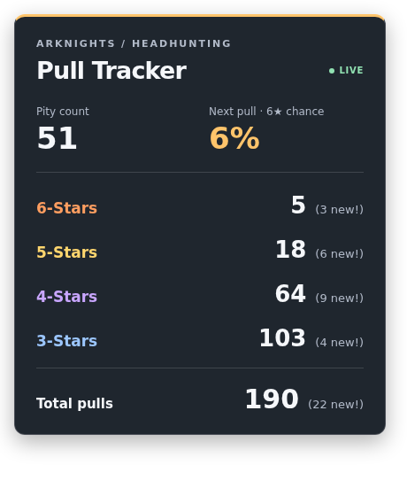

# OBS overlay: setup and Go walkthrough

The desktop tracker owns the counters. The overlay displays a copy of its current
state, including changes caused by undo, redo, and reset. Open the tracker before
opening the overlay. Nothing needs to be deployed to the internet.



The image uses demonstration values; the real page reads the running tracker.

## Run it

1. Build the whole package using your existing working Windows build setup. Use
   `go build -o test.exe .` if that shell is already configured to build Windows
   executables. Keep your existing `GOOS`, `CGO_ENABLED`, and C compiler settings
   when cross-compiling from WSL. The final `.` includes all the Go source files;
   building only `main.go` will not include the new server.
2. Launch the rebuilt executable. Its window starts the overlay server too.
3. Open <http://127.0.0.1:8080/> in a normal browser. Clicking a rarity button
   should change the corresponding number on the page within about a quarter
   second on an otherwise responsive machine.
4. In OBS, add a **Browser Source**, leave **Local file unchecked**, and enter
   `http://127.0.0.1:8080/`. Start with **Width 460** and **Height 560**.
5. Keep the tracker running during the stream. Position or scale the source in
   OBS as needed. The page background is transparent; the panel has a translucent
   dark background for readability.

The executable contains its own copy of `overlay.html`. You need the HTML file in
the project when compiling, but you do not need it beside the finished EXE. After
editing the HTML or CSS, rebuild, restart the tracker, and refresh the OBS source
to load the new design. Counter changes do not require a page refresh.

## Files

| File | Purpose |
| --- | --- |
| `overlay.html` | HTML elements, CSS appearance, and JavaScript polling |
| `overlay.go` | JSON data type, synchronized snapshot storage, and HTTP server |
| `startup.go` | Creates the snapshot store, starts the server, and closes it when Fyne quits |
| `update_UI.go` | Publishes the currently selected history snapshot after updating the labels |
| `overlay_test.go` | HTTP, JSON, concurrency, and server lifecycle tests |

`main.go`, your existing counting callbacks, and the history manager keep their
existing responsibilities. The server adds no new Go module dependencies.

## 1. Embed the HTML

In `overlay.go`:

```go
import _ "embed"

//go:embed overlay.html
var overlayHTML string
```

`//go:embed` is a compiler directive. When Go builds the program, it reads the file
relative to this Go package's directory and puts the contents into `overlayHTML`.
That variable is a regular string at runtime. Serving the page does not open a
file, depend on the current working directory, or require a template engine.

The blank import `_ "embed"` makes the embedding feature available without
introducing a package name used elsewhere in this source file. It is required
even though the variable is a string rather than an `embed.FS`.

Official reference: <https://pkg.go.dev/embed>.

## 2. Give JSON an explicit data type

Your `State` has lowercase field names. Those fields are private to the package,
so the JSON encoder does not automatically serialize them. Instead of renaming
your existing fields, `overlayData` defines an explicit representation of what
the browser needs:

```go
type overlayData struct {
    SixStarCount int `json:"sixStarCount"`
    // The full definition includes all twelve displayed values.
}
```

`SixStarCount` starts with a capital letter, so `encoding/json` can read it. The
struct tag chooses the JSON property's name. JavaScript therefore receives
`"sixStarCount": 5`, rather than `"SixStarCount": 5`.

The type name `overlayData` can remain lowercase. It is the fields that must be
exported for the encoder. There are no Fyne widgets, history slices, or mutexes
in this data type; all twelve fields are integers.

Official reference: <https://pkg.go.dev/encoding/json#Marshal>.

## 3. Share a copy between the UI and server

HTTP requests are handled in goroutines, while your Fyne button callbacks update
the history from the UI goroutine. Letting a handler read `log.history` while a
callback appends to it or changes `currentState` would introduce a data race.

The solution is a separate store:

```go
type overlayStore struct {
    mu   sync.RWMutex
    data overlayData
}
```

`data` holds the latest published copy. `mu` protects access to that copy:

- `publish` takes `Lock`, replaces the entire data struct, and calls `Unlock`.
- `snapshot` takes `RLock`, copies the data struct, and calls `RUnlock`.

A writer gets exclusive access; readers may share access with other readers.
The copy prevents the server from reading half of one published snapshot and
half of another.

```go
func (s *overlayStore) snapshot() overlayData {
    s.mu.RLock()
    defer s.mu.RUnlock()
    return s.data
}
```

The receiver is a pointer so all calls use the same store and mutex. Copying a
mutex after it has been used is not allowed. The returned `overlayData` is a
value, however: because it contains only integers, the result is an independent
copy. Go evaluates that return value before running the deferred unlock.

The lock is released before the handler encodes JSON or writes to the browser.
A slow browser connection therefore does not hold the lock while transmitting
its response. This design relies on keeping history and widget access on the UI
goroutine. If you later add HTTP endpoints that change counters, those writes
will need to be routed back to the UI rather than modifying history directly.

Official reference: <https://pkg.go.dev/sync#RWMutex>.

## 4. Publish from `updateUI`

At the end of your existing `updateUI`, a struct literal maps `State`'s lowercase
fields into the browser data type:

```go
ui.overlay.publish(overlayData{
    SixStarCount: state.sixStarCount,
    // The real implementation maps every displayed field here.
    SixStarChance: state.sixStarChance(),
})
```

The browser receives the state selected by `log.currentState`, not necessarily
the newest entry in the history. That is why undo works automatically. Your
increment buttons, undo, redo, reset, and initial startup already call
`updateUI`; they all publish through this one integration point.

The six-star chance is still calculated by your Go method. JavaScript does not
reimplement the pity formula, count pulls, or maintain its own history.

## 5. Route incoming requests

`newOverlayHandler` creates a private `http.ServeMux`. A mux selects which handler
function receives a request based on its path:

| Request | Response |
| --- | --- |
| `GET /` | The embedded HTML document |
| `GET /state` | The latest counter snapshot as JSON |
| `HEAD /` or `HEAD /state` | Response headers without a body |
| Other paths | `404 Not Found` |
| Unsupported methods on the two routes | `405 Method Not Allowed` |

The `/` handler checks the exact path because a ServeMux pattern of `/` also
matches otherwise unmatched paths. The server does not expose your project
directory or serve arbitrary local files.

Both handlers receive `w http.ResponseWriter` and `r *http.Request`. You already
know the client side of HTTP: `r` is the incoming request, and `w` is what the
handler writes the outgoing response into.

`Content-Type` tells the browser whether the body is HTML or JSON. `Cache-Control:
no-store` asks it not to save stale copies. Set headers before writing the body;
the first body write implicitly sends a `200 OK` response if no other status
has been chosen.

The page handler uses `io.WriteString(w, overlayHTML)` to write the embedded
string. The state handler uses:

```go
json.NewEncoder(w).Encode(store.snapshot())
```

`ResponseWriter` implements `io.Writer`, so a JSON encoder can write directly to
the response. The encoder receives a copied snapshot, serializes its exported
fields, writes the JSON, and appends a newline. If the browser disconnects while
the response is being written, the error is logged rather than terminating the
tracker.

Official reference: <https://pkg.go.dev/net/http#ServeMux>.

## 6. Listen, then serve concurrently

`startOverlayServer` first calls:

```go
listener, err := net.Listen("tcp", address)
```

`127.0.0.1` is the loopback address of this computer; `8080` is the chosen port.
The listener reserves that local address. It does not make the tracker publicly
accessible. OBS should run on the same Windows computer as the EXE for this
setup.

Calling `Listen` before creating a goroutine lets startup detect a port conflict
immediately. If another program or tracker instance already owns that port, the
function returns an error. `%w` in `fmt.Errorf` wraps the original error while
adding the address to its message.

After obtaining the listener, the function constructs an `http.Server` with the
mux and some timeouts. `ReadHeaderTimeout` bounds the time allowed to receive
headers, `WriteTimeout` bounds response writing, and `IdleTimeout` limits how
long an unused keep-alive connection is retained.

`server.Serve(listener)` waits for connections and blocks until it stops. Calling
it directly in `initializeApp` would prevent that function from returning and
your existing `a.Run()` from starting. Instead:

```go
go func() {
    // server.Serve(listener), with error handling
}()
```

This starts a goroutine and returns control to Fyne's startup code. The `()`
invokes the anonymous function; `go` makes that invocation concurrent. The
server itself arranges goroutines for incoming connections. No manually created
goroutine touches Fyne widgets.

When the server is intentionally closed, `Serve` returns `http.ErrServerClosed`.
`errors.Is` filters that expected result; unexpected server failures are logged.

Official reference: <https://pkg.go.dev/net/http#Server.Serve>.

## 7. Start and stop it with the window

`initializeApp` creates the store along with your labels and buttons. After all
widgets exist, it calls `updateUI` to populate both the UI and the store, then
starts the server. A browser can never see the store's uninitialized rate of
zero because publication happens before listening starts.

If startup fails, a message appears below the desktop controls. The tracker
still runs. Close the other tracker process if the port is occupied. If another
application needs that port, change `overlayAddress` in `overlay.go`, rebuild,
and use the matching URL in OBS.

On success, the application registers:

```go
a.Lifecycle().SetOnStopped(func() {
    _ = server.Close()
})
```

This callback closes the listener when the application quits. `_ =` explicitly
discards the cleanup error. It does not close the server immediately. Avoid
`defer server.Close()` inside `initializeApp`: that would close it as soon as
that function returns, just before `main` calls `a.Run()`.

`Close` is sufficient here because these are short, read-only requests. The
browser retries interrupted requests. A server performing long transactions
would usually use `Shutdown` with a context and an appropriate grace period.

Official reference: <https://docs.fyne.io/api/v2/fyne/lifecycle/>.

## 8. What the browser does

HTML creates named elements such as `<span id="sixStarCount">`. CSS styles them.
The small JavaScript function requests `/state`, checks for a valid response,
and assigns the returned numbers to each matching element's `textContent`.
This changes the already loaded page; it does not rewrite or reload the file.

The page and data share one server, so `/state` is a relative, same-origin URL.
No CORS configuration, POST request, WebSocket, framework, or Node server is
needed. Everything needed by the browser is included in the HTML.

After each completed request, the function schedules the next one after 250 ms.
Using a repeated timeout rather than a fixed interval avoids overlapping
requests. An `AbortController` cancels a request that takes over two seconds.
If the tracker becomes unavailable, the last valid counts remain visible and
the connection badge changes to `RECONNECTING`. Restarting the tracker at the
same address lets the existing page recover automatically. Restarting the EXE
still resets the counters, as it did before; this feature does not add disk
persistence.

## Verify before streaming

Record a normal pull and a new pull, then undo, redo, reset, and undo the reset.
Verify both displays agree, including total-new and the six-star chance. After
undoing, record a different pull and check that the old redo path disappears.

For the server's automated checks, without requiring Fyne or a display:

```sh
go test -race overlay.go overlay_test.go
```

This selects the server source and its tests explicitly. It verifies all JSON
fields, cache headers, page serving, invalid requests, synchronized access, port
conflicts, shutdown, and restart. It does not launch a Windows GUI or OBS.

To compile and run the package tests with Fyne's headless driver:

```sh
go test -tags ci ./...
```

You can inspect the raw JSON at <http://127.0.0.1:8080/state> if a displayed value
looks wrong. If the JSON is right, inspect the HTML/JavaScript; if it is wrong,
inspect `updateUI`'s mapping and the selected history state.
